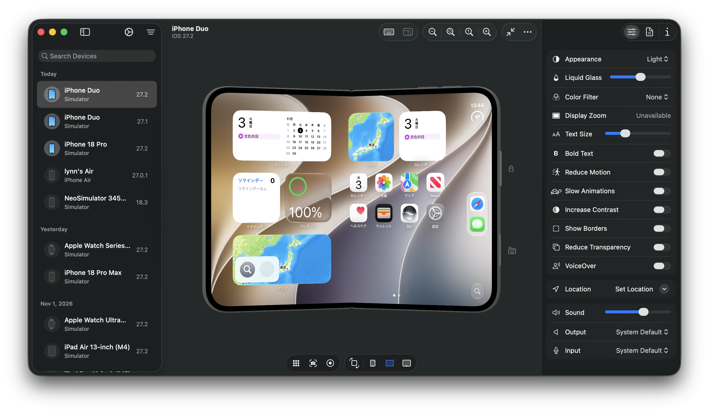

# NeoSimulator

[English](README.md) | [Japanese](README.ja.md)

NeoSimulator は、iPhone、iPad、Apple Watch、Apple TV、Apple Vision Pro に対応した軽量シミュレーターアプリです。

## 動作環境

- Apple Silicon 搭載 Mac
- macOS 26.4 以降
- Xcode 27 以降（シミュレータのランタイムをインストール済みであること）

## インストール

[Releases](https://github.com/lynnswap/NeoSimulator/releases) から DMG をダウンロードして開き、**NeoSimulator.app** を **Applications** にドラッグします。

初期設定では、アプリの起動中に NeoSimulator でシミュレータを表示します。通常終了すると Xcode の表示設定を元に戻します。表示先は **Settings → General → Preferred Display Host** で変更できます。

## ドキュメント

- [ユーザーガイド（英語）](https://lynnswap.github.io/NeoSimulator/documentation/neosimulator/)
- [CLI 版からの移行](Documentation/MigratingFromCLI.ja.md)
- [開発ガイド（英語）](Documentation/NeoSimulator.docc/Development.md)

## 謝辞

バックグラウンドサービスの制御は、停止しても安全なサービスの一覧を含めて [simslim](https://github.com/MobAI-App/simslim) から移植しています。Interlap と [simslim のコントリビューター](https://github.com/MobAI-App/simslim/graphs/contributors)に感謝します。simslim は MIT ライセンスで公開されています。NeoSimulator はその許諾表示を [Credits.rtf](App/Credits.rtf) に収録し、About ウインドウに表示します。

## ライセンス

[MIT](LICENSE)
