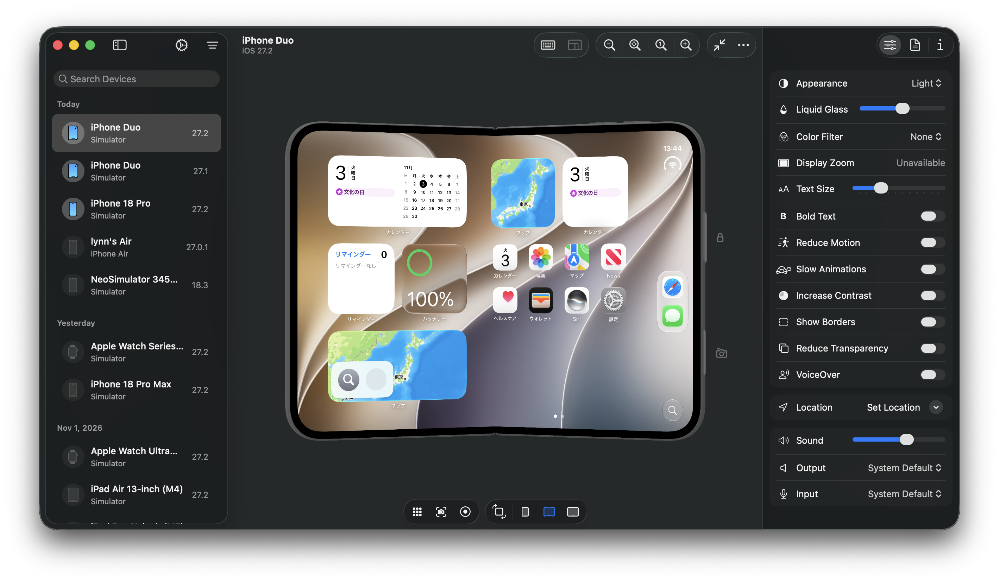

# NeoSimulator

[English](README.md)

NeoSimulator は、iPhone、iPad、Apple Watch、Apple TV、Apple Vision Pro のシミュレータを Mac で操作するためのアプリです。

## インストール

Apple シリコン搭載の Mac、macOS 26.4 以降、Xcode 27 以降が必要です。使いたいシミュレータのランタイムを Xcode でインストールしてください。

[Releases](https://github.com/lynnswap/NeoSimulator/releases) から DMG をダウンロードし、**NeoSimulator.app** を「アプリケーション」フォルダにドラッグします。

NeoSimulator を起動すると、Xcode のシミュレータの表示先が NeoSimulator に変わります。この設定は終了後も残ります。元に戻すには、アンインストールする前に **Settings → General → Restore Original Settings…** を選んでください。

## ドキュメント

- [SDK の使い方（英語）](https://lynnswap.github.io/NeoSimulator/documentation/neosimulator/usingthesdk)
- [CLI 版からの移行](Documentation/MigratingFromCLI.ja.md)
- [不具合報告とプルリクエスト（英語）](CONTRIBUTING.md)

## 謝辞

バックグラウンドサービスの制御機能と、停止しても安全なサービスの一覧は [simslim](https://github.com/MobAI-App/simslim) から移植しました。Interlap と [simslim のコントリビューター](https://github.com/MobAI-App/simslim/graphs/contributors)に感謝します。simslim の MIT ライセンスと依存パッケージのライセンスは **Settings → Licenses** で確認できます。

## ライセンス

[MIT](LICENSE)
