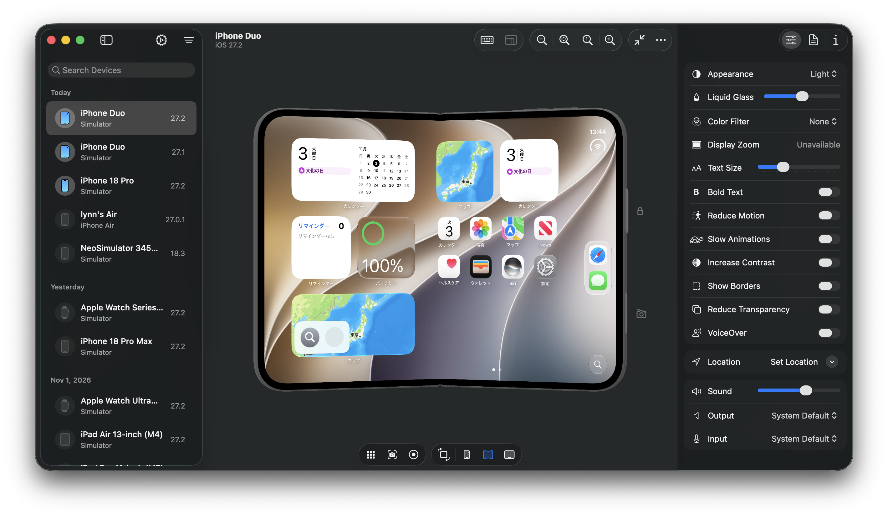

# NeoSimulator

[日本語](README.ja.md)

NeoSimulator is a Mac app for viewing and controlling iPhone, iPad, Apple Watch,
Apple TV, and Apple Vision Pro simulators.

## Installation

You'll need an Apple silicon Mac running macOS 26.4 or later, Xcode 27 or later,
and a simulator runtime installed in Xcode.

Download the DMG from [Releases](https://github.com/lynnswap/NeoSimulator/releases)
and drag **NeoSimulator.app** to **Applications**.

On launch, NeoSimulator sets itself as Xcode's preferred display host. Quitting
leaves that setting in place. To undo the change before uninstalling, use
**Settings → General → Restore Original Settings…**.

## Documentation

- [Using the SDK](https://lynnswap.github.io/NeoSimulator/documentation/neosimulator/usingthesdk)
- [Migrating from the CLI](Documentation/MigratingFromCLI.md)
- [Contributing](CONTRIBUTING.md)

## Acknowledgements

NeoSimulator's background service controls and list of services that are safe
to stop come from [simslim](https://github.com/MobAI-App/simslim). Thanks to
Interlap and the [simslim contributors](https://github.com/MobAI-App/simslim/graphs/contributors).
Its MIT notice and the dependency licenses are in **Settings → Licenses**.

## License

[MIT](LICENSE)
