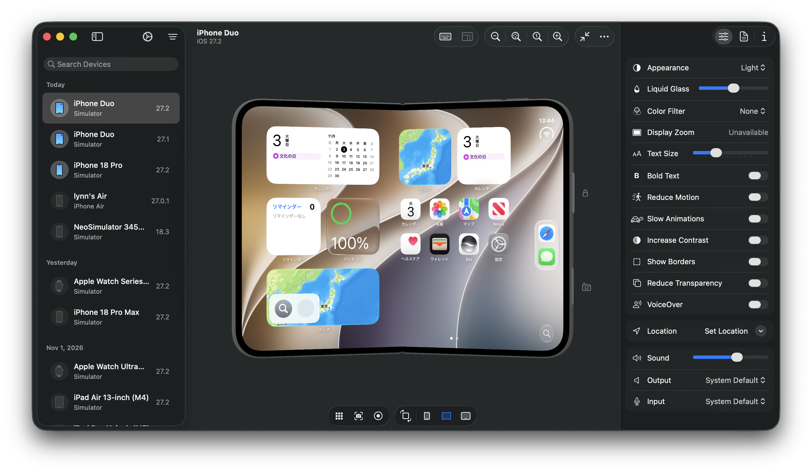

# NeoSimulator

[English](README.md) | [Japanese](README.ja.md)

NeoSimulator is a lightweight simulator app for iPhone, iPad, Apple Watch, Apple TV,
and Apple Vision Pro.



## Requirements

- Apple Silicon Mac
- macOS 26.4 or later
- Xcode 27 or later, with simulator runtimes installed

## Installation

Download the DMG from [Releases](https://github.com/lynnswap/NeoSimulator/releases),
open it, and drag **NeoSimulator.app** to **Applications**.

By default, NeoSimulator displays simulators while the app is open. Your selected
display host is kept after quitting. To use Device Hub, choose it under
**Settings → General → Preferred Display Host**.

## Documentation

- [User guide](https://lynnswap.github.io/NeoSimulator/documentation/neosimulator/)
- [Migrating from the CLI](Documentation/MigratingFromCLI.md)
- [Development](Documentation/NeoSimulator.docc/Development.md)

## Build a simulator app

The `NeoSimulatorKit` Swift package product provides simulator discovery, device state,
boot and shutdown, with no presentation dependency. The `NeoSimulatorUI` product presents
those devices on AppKit screens. Both require Swift 6.4 and the same macOS and Xcode versions
as the application.

```swift
import NeoSimulatorKit
import NeoSimulatorUI

let context = try await SimulatorContext.load()
let devices = try await context.devices()
if let device = devices.first {
    _ = try await context.boot(device.id)
    let screens = try await SimulatorScreens(context: context)
    let screen = try await screens.open(device.id)
    try screen.showWindow()
    // Retain context, screens and screen while presenting the simulator.
}
```

Use `SimulatorScreenViewController(screen:)` to embed the screen in an AppKit
container. `screen.session` is the open device: its model, guest commands, and the readiness of
its optional services. A screen is usable before those services are, and a service that fails
says so without another transport taking its place. `screen.close()` and `context.invalidate()`
release presentation resources while leaving guests running; `context.shutDown(_:)` explicitly
stops a guest. Finish these asynchronous operations before terminating your app so their errors
can be reported.

See [MinimalSimulatorApp](Examples/MinimalSimulatorApp) for a separate package
that uses only the public products, including cleanup and an automatic open/close
exercise.

## Acknowledgements

Background service control is ported from [simslim](https://github.com/MobAI-App/simslim), including its catalog of services that are safe to stop. Thank you to Interlap and the [simslim contributors](https://github.com/MobAI-App/simslim/graphs/contributors). simslim is available under the MIT License. Its notice and the licenses of NeoSimulator's package dependencies are available in **Settings → Licenses**.

## License

[MIT](LICENSE)
